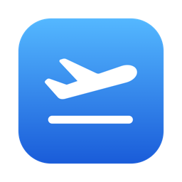

<p align="center"></p>

<h1 align="center">Layover</h1>

<p align="center">
A macOS menu bar app that sends <b>only one Chrome window</b> through your WireGuard VPN.<br>
Everything else on your Mac stays on your normal connection.
</p>

<p align="center"><a href="#한국어">한국어</a></p>

---

## Why

Most VPN apps route your whole Mac. Layover is for when you only want *some* browsing
to come out somewhere else — Korean banking from abroad, a US-only store, a streaming
site — without slowing down or relocating everything else.

- Bring your own WireGuard config — from your VPN provider's "manual configuration"
  page or your own server
- One click to connect; switch locations from the menu
- **"Open VPN Chrome"** opens a separate Chrome window (its own profile) that uses the
  tunnel. Your normal Chrome and other apps are untouched
- No root, no kernel/system extension, no Apple Developer account: WireGuard runs in
  userspace ([wireguard-go](https://git.zx2c4.com/wireguard-go) + gVisor netstack)
  and is exposed as a local SOCKS5 proxy
- DNS is resolved inside the tunnel; WebRTC is restricted so it can't leak your real IP

## Install

Requires macOS 13 or later (Apple Silicon or Intel) and Google Chrome.

1. Download `Layover-x.y.z.dmg` from [Releases](https://github.com/J1wanSeo/layover/releases),
   open it, and drag `Layover.app` onto `Applications`. (A `.zip` is also provided.)
2. Layover is not notarized by Apple, so the first launch is blocked. Open it once, then go to
   **System Settings → Privacy & Security** and click **Open Anyway**.
   (Or build it yourself — see below — and no warning appears.)

## Usage

> The menu is in Korean for now (English labels below are translations). English UI is planned.

1. Get a WireGuard config (`.conf`) from your VPN provider. Look for "manual
   configuration", "WireGuard configuration" or "router setup". Choose platform
   *Linux* if asked; any standard `wg-quick` file works.
2. Menu bar icon → **Add config file…** → pick the `.conf` → give it a name (e.g. `seoul`).
   The file is validated and copied to `~/.config/myvpn/` (mode 600). Layover offers to
   move the original to the Trash, because it contains your private key.
3. **Connect.** The menu shows the exit IP and city once the server answers.
4. **Open VPN Chrome.**

| Menu bar icon | State |
|---|---|
| `airplane.arrival` | Disconnected |
| `airplane.departure` | Connecting |
| `airplane.circle.fill` | Connected |
| `exclamationmark.triangle` | Failed (reason in menu) |

Quitting Layover — or Layover crashing — always shuts the tunnel down.

### Command line

The app bundles the `myvpn` CLI, which works on its own:

```sh
myvpn list              # saved configs
myvpn check seoul       # validate a config without connecting
myvpn up seoul          # start tunnel + SOCKS5 on 127.0.0.1:1080 (Ctrl+C to stop)
myvpn chrome            # open the VPN Chrome window
```

Any app that supports a SOCKS5 proxy can use `127.0.0.1:1080` while the tunnel is up.

## Limitations

- **Chrome only** (plus apps you point at the SOCKS5 proxy yourself). Apps without proxy
  support, such as KakaoTalk, can't be routed. True per-app routing on macOS needs a
  Network Extension, which requires a paid Apple Developer account.
- **TCP only.** Chrome falls back from QUIC to TCP automatically.
- **WireGuard is UDP.** Networks that block UDP (some hotels and airports) can't connect;
  Layover tells you when the server never answers.
- The VPN Chrome window uses its own profile. Sign in to Chrome sync there if you want your
  bookmarks and passwords.
- After connecting, Layover asks `https://ipinfo.io` (through the tunnel) for the exit IP and city.
- The SOCKS5 proxy listens on localhost only, without authentication. Other programs on your
  Mac can use it while it's running.

## Build from source

Needs Go 1.25+ and Xcode Command Line Tools (`xcode-select --install`). Xcode itself is not required.

```sh
./scripts/build-app.sh          # → build/Layover.app (universal), Layover-<version>.dmg and .zip
swift scripts/make-icon.swift   # only to regenerate packaging/AppIcon.icns
go test ./...
```

The version comes from `packaging/Info.plist` (`CFBundleShortVersionString`).

## License

[MIT](LICENSE). Bundled third-party licenses: [THIRD_PARTY_LICENSES.txt](THIRD_PARTY_LICENSES.txt).

Layover is not affiliated with any VPN provider. Use it with configs from services you
subscribe to, and follow their terms.

---

## 한국어

**Layover**는 macOS 메뉴바 앱으로, **Chrome 창 하나만** WireGuard VPN으로 보내요.
나머지 앱과 평소 쓰는 Chrome은 원래 인터넷 연결을 그대로 써요.

- VPN 업체의 "수동 설정(Manual configuration)" 페이지나 직접 운영하는 서버에서 받은 WireGuard `.conf`를 넣어 쓰면 돼요.
- 메뉴에서 한 번 눌러 연결하고, 위치도 메뉴에서 바꿔요.
- **VPN Chrome 열기**를 누르면 별도 프로필의 Chrome 창이 열리고, 그 창만 VPN을 타요.
- 관리자 권한이나 Apple 개발자 계정이 필요 없어요.

### 설치
1. [Releases](https://github.com/J1wanSeo/layover/releases)에서 `.dmg`를 받아 열고, `Layover.app`을 `Applications`로 끌어다 놓아요.
2. Apple 공증을 받지 않은 앱이라 처음 열면 실행이 막혀요. 한 번 연 다음 **시스템 설정 → 개인정보 보호 및 보안 → 그래도 열기**를 누르세요.

### 사용법
1. VPN 업체에서 WireGuard 설정 파일을 받아요. 플랫폼을 고르라고 하면 *Linux*를 고르세요.
2. 메뉴바 아이콘 → **설정 파일 추가…** → 이름 입력(예: `seoul`). 원본 파일에는 개인키가 들어 있어서, 휴지통으로 옮길지 물어봐요.
3. **연결**을 누르면 연결된 뒤 출구 IP와 도시가 메뉴에 표시돼요.
4. **VPN Chrome 열기**를 눌러요.

### 한계
- Chrome 전용이에요. KakaoTalk처럼 프록시 설정이 없는 앱은 VPN으로 보낼 수 없어요.
- TCP만 지원해요. Chrome은 자동으로 TCP를 써서 문제없어요.
- WireGuard는 UDP를 써요. UDP를 막는 네트워크에서는 연결이 안 되고, 그때 메뉴에 이유가 표시돼요.
- 연결 후 출구 IP를 확인하려고 터널을 통해 ipinfo.io에 요청을 보내요.
